# Home System

Eine Flutter-App für Android-TV-Boxen, Fire TV und Fernseher, komplett per
Fernbedienung (D-Pad) bedienbar. Sie besteht aus drei Teilen:

- **Launcher**: der Startbildschirm mit Radio, TV und den eigenen Apps
  (Netflix, Disney+, Spotify, …), erreichbar über die Home-Taste.
- **Radio**: DAB+-Radio (über einen RTL-SDR-USB-Stick), UKW, Internetradio,
  Wetter, Wetterradar und eine Sonne-&-Mond-Kachel.
- **TV**: Fernsehen vom eigenen Enigma2-Sat-Receiver (z. B. GigaBlue) mit
  Senderliste, Senderlogos und Programmführer.

Eine App für jedes Gerät: Beim Start zeigt sie wahlweise den Launcher, startet
Radio mit einem Sender (z. B. draußen) oder TV mit einem Sender (z. B.
am Fernseher).

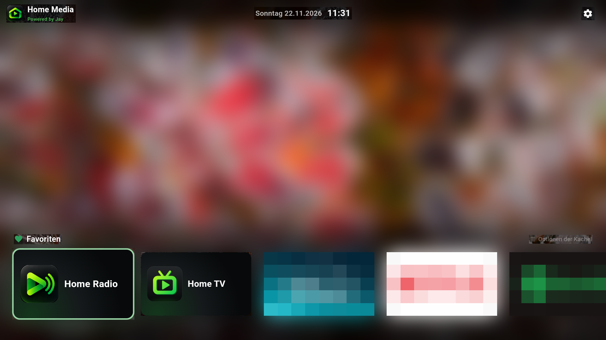

## Warum diese App?

DAB+ und Internetradio haben jeweils ihre Lücken: Manche Sender gibt es über DAB+
gar nicht, und manche Internetstreams klingen deutlich schlechter als der gleiche
Sender über DAB+. Radio führt beides in **einer gemeinsamen Senderliste**
zusammen. Jeder Favorit bekommt eine Programmnummer wie ein klassischer Kanalplatz,
egal ob er über DAB+ oder das Internet kommt. So hört man jeden Sender über den
jeweils besseren Weg, ohne zwischen Apps zu wechseln.

## Screenshots

### Launcher und TV

| | |
|---|---|
| 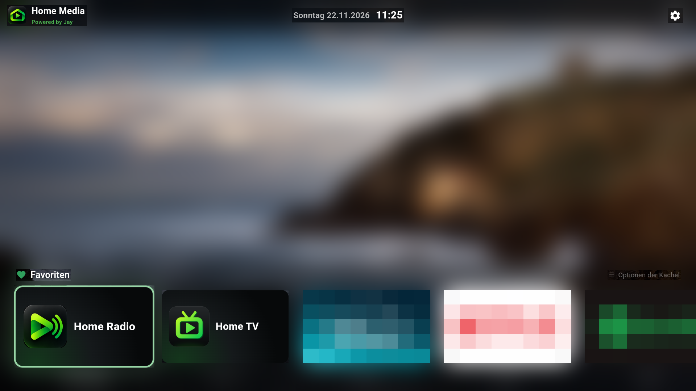 | 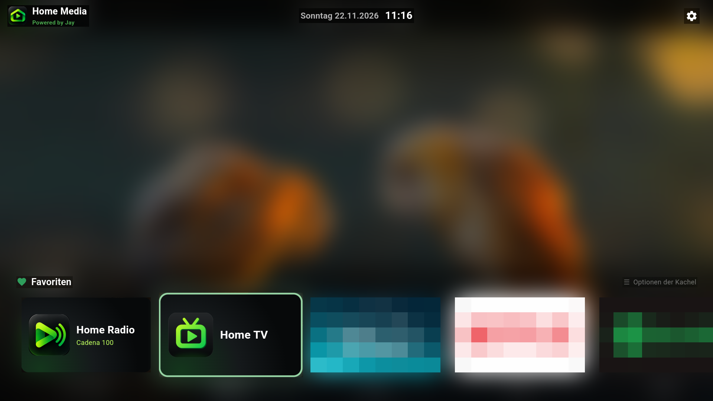 |
| 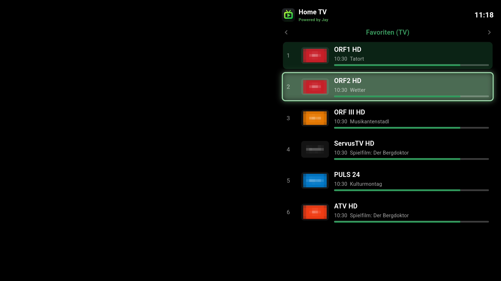 | 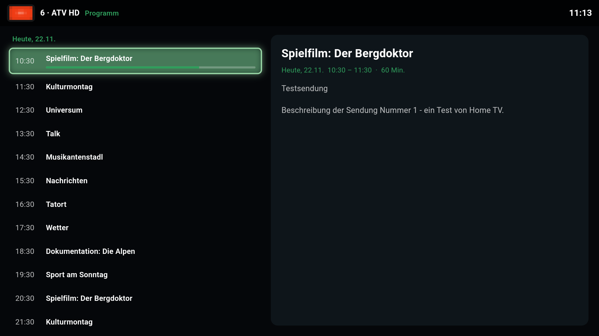 |
| 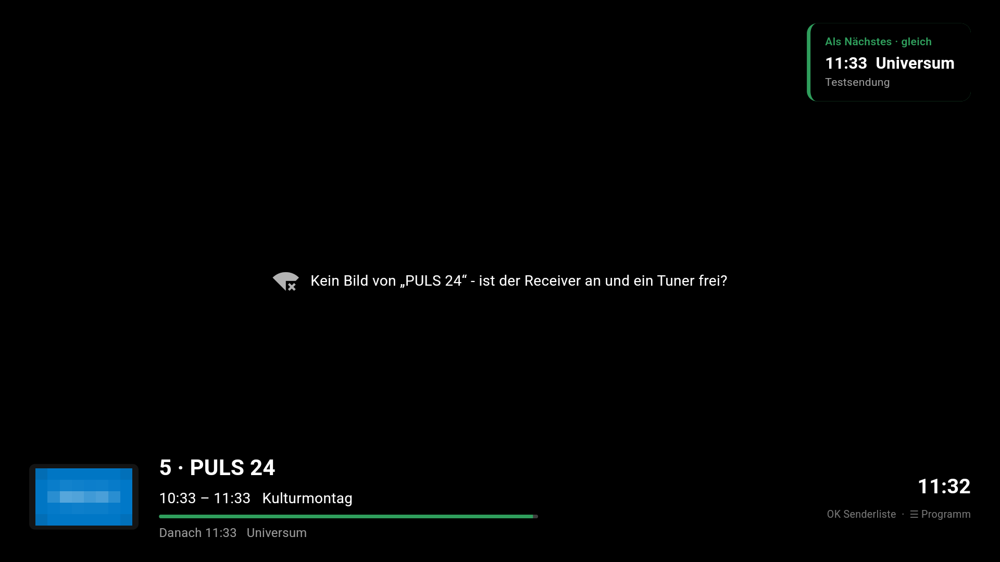 | 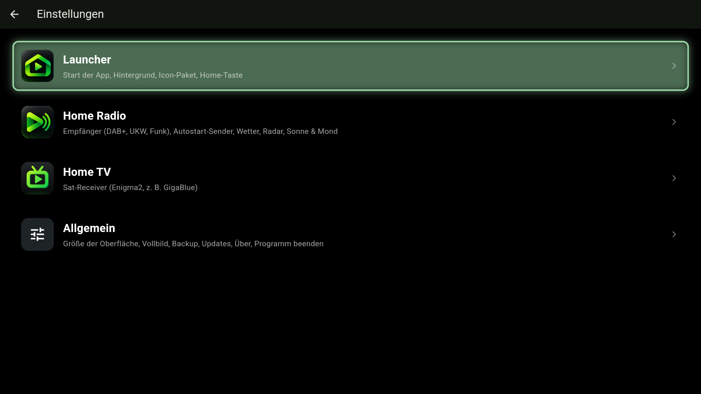 |
| 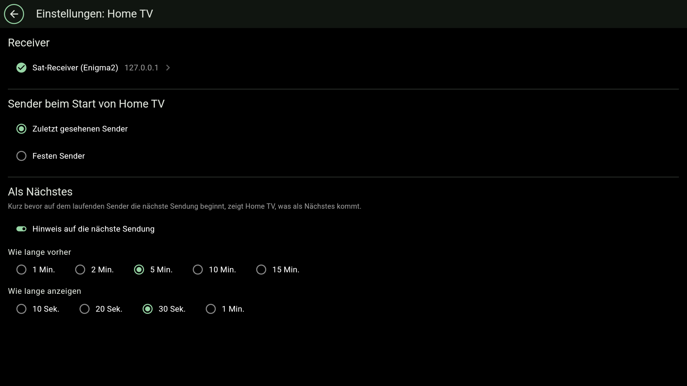 |  |

### Radio

| | |
|---|---|
|  | 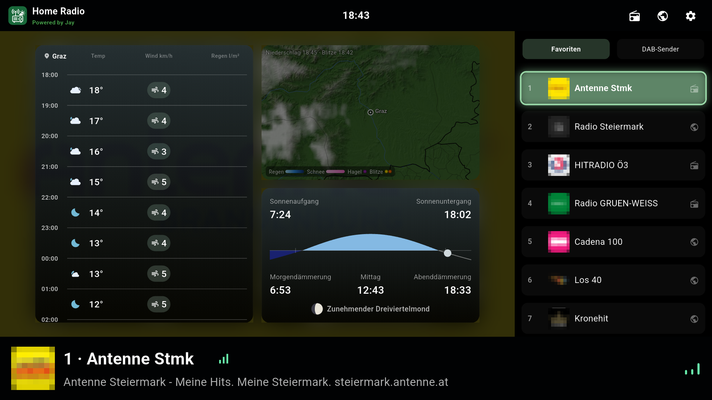 |
|  | 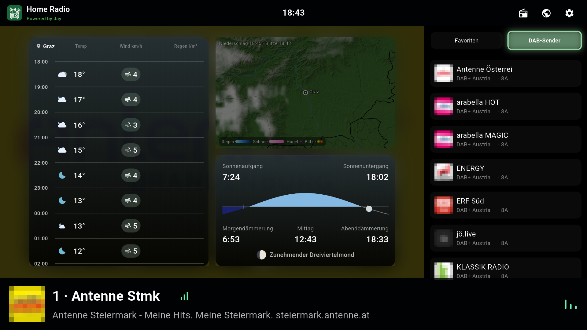 |
| 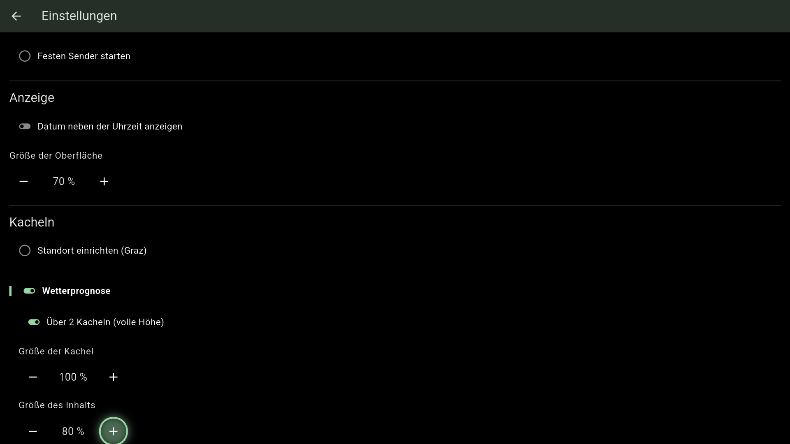 | 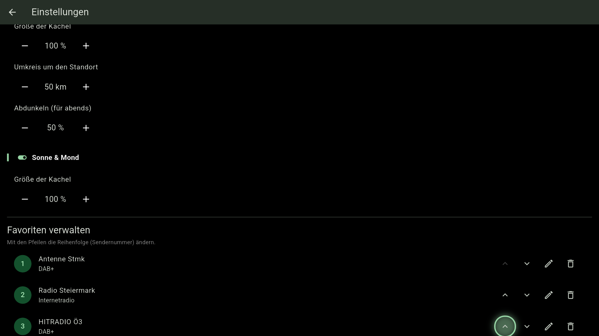 |
| 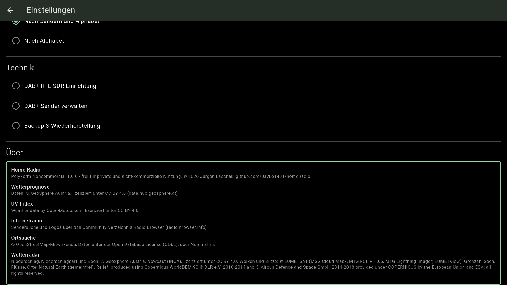 | 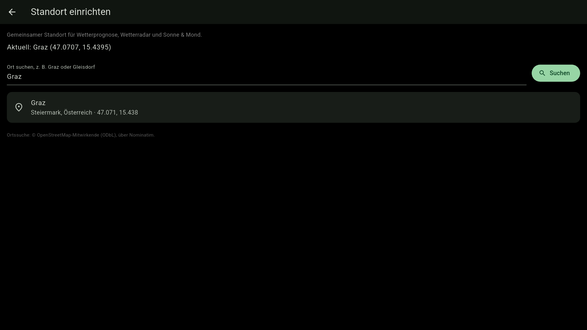 |

Senderlogos und App-Logos sind in den Screenshots unkenntlich gemacht (Marken
der jeweiligen Sender und Anbieter), die Hintergrundfotos des Launchers
weichgezeichnet (Rechte bei den Fotografen). Die Home-TV-Screenshots stammen von
einem Test-Receiver ohne Livebild.

## Funktionen

### Launcher
- **Favoriten-Leiste** mit Radio, TV und beliebigen installierten Apps;
  die Kacheln zeigen die Original-Banner der Apps. Verschieben, Bild ändern oder
  entfernen über ☰ (Menü-Taste) oder langes OK.
- **Alle Apps** mit Suche; Apps per ☰ oder langem OK zu den Favoriten.
- **Eigene Kachelbilder**: Icon-Pakete (ADW-/Nova-Format) oder ein Bild per
  Adresse, z. B. vom eigenen Server.
- **Hintergrund**: Farbverläufe (ohne Internet), Landschaftsfotos aus dem Internet
  (Bing-Bilder des Tages, mit Bildnachweis) oder ein eigener Server (Bild,
  JSON-Liste oder Ordneransicht von nginx/Apache/`python -m http.server`);
  Wechselintervall und Deckkraft des Favoriten-Bands einstellbar.
- Startet eine andere App, pausieren Radio und TV; Radio spielt beim
  Zurückkommen weiter.
- Oben die gleiche Leiste wie in Radio; das Zahnrad öffnet die
  App-Einstellungen, die Android-Einstellungen oder „Alle Apps“.

### Home-Taste
- Home System ist als Startbildschirm (HOME) registriert - auf Android-TV-Boxen
  als Standard-Launcher wählbar.
- Auf **Fire TV** und **Google TV**, die keinen anderen Launcher zulassen, holt die
  Bedienungshilfe „Home System: Home-Taste“ Home System nach vorne, sobald der
  Startbildschirm des Geräts erscheint (sieht nur, welche App vorne ist - keine
  Inhalte, keine Eingaben). Auf Fire TV fängt sie zusätzlich die Home-Taste
  selbst ab: Fire OS lässt nach Home 5 Sekunden lang keine andere App nach vorne,
  so öffnet Home System sofort statt nach Amazons Startbildschirm; lang drücken
  öffnet weiter Amazons Schnellmenü, alle anderen Tasten bleiben unberührt.
  Einschalten unter Einstellungen → Launcher →
  Home-Taste; bei Apps außerhalb eines App-Stores einmalig per adb freischalten:

  ```bash
  adb shell pm grant at.jaycloud.home.system android.permission.WRITE_SECURE_SETTINGS
  adb shell appops set at.jaycloud.home.system ACCESS_RESTRICTED_SETTINGS allow
  ```

  Nach App-Updates schaltet Home System den Dienst selbst wieder ein.

### TV
- Für Enigma2-Receiver mit **OpenWebif** (GigaBlue, VU+, Dreambox mit teamBlue,
  OpenATV, OpenPLi): Senderlisten (Bouquets), Senderlogos (Picons) und der
  Programmführer kommen vom Receiver, das Bild über seinen Streaming-Port.
- Umschalten mit hoch/runter, Kanaltasten, ⏪/⏩ oder Ziffern; OK öffnet die
  Senderliste (← / → wechseln die Liste), ☰ den Programmführer des Senders.
- Info-Banner mit Jetzt/Danach und Fortschritt; **„Als Nächstes“**-Hinweis kurz vor
  der nächsten Sendung (Vorlauf und Anzeigedauer einstellbar, Standard 5 Minuten
  vorher, 30 Sekunden).
- Start mit dem zuletzt gesehenen oder einem festen Sender.

### Beim Start der App
- Launcher anzeigen, Radio mit Sender starten (siehe Autostart) oder TV
  mit Sender starten - einstellbar unter Einstellungen → Launcher.

## Radio

### DAB+-Radio
- Empfang über einen **RTL-SDR-USB-Stick** (RTL2832U-basiert, getestet mit einem
  Nooelec-Stick), wahlweise:
  - **direkt per USB** am TV-Gerät angeschlossen, oder
  - über **rtl_tcp** von einer Quelle im lokalen Netz (z. B. einem Raspberry Pi
    mit angeschlossenem Stick oder einem
    [rtltcp.server](https://github.com/JayLo1401/rtltcp.server)) - Host/Port
    einstellbar. Das Protokoll wird automatisch erkannt: klassisches
    **rtl_tcp** oder **rtl_tcp Jay extended** (rtltcp.server), das zusätzlich
    den Namen des Sticks und Meldungen wie „Stick nicht bereit“ oder „belegt
    durch …“ liefert. Sticks an anderen Standorten stellt der rtltcp.server über
    rtl.over.internet lokal bereit; home.radio selbst braucht keine Anmeldung.
- Vollständiger nativer OFDM-Demodulator/DAB+-Decoder (Tuning, FIC/MSC-Decoding,
  Reed-Solomon-Fehlerkorrektur, AAC-Decodierung) - kein Rückgriff auf eine externe
  DAB-App.
- **Sendersuchlauf** über Band III, gefundene Sender werden dauerhaft gespeichert
  (unabhängig von Favoriten, jederzeit erneut favorisierbar ohne neuen Suchlauf).
- **Favoriten mit Programmnummern** (wie ein klassischer Kanalplatz), gemeinsam für
  DAB+-, UKW- und Internetradio-Sender. Die Senderleiste der Startseite hat die
  Reiter ♥ (Favoriten), „DAB+“ und „FM“; Favoriten sind dort direkt bearbeitbar
  (Stift-Symbol): umsortieren, umbenennen, entfernen.
- **Senderlogos**:
  - *„Fehlende Logos per Empfang holen“* (neben dem Suchlauf): tunt alle Sender
    ohne Logo durch und wartet auf ein über DAB+ ausgestrahltes
    MOT-Slideshow-Bild; vorhandene Logos bleiben unangetastet.
  - *„Logo wählen“* pro Sender: „DAB-Logo holen“ (Bild genau dieses Senders
    empfangen) oder aus Internet-Treffern der Radio-Browser-API wählen (breite
    Suche über alle Namensteile, Treffer aus AT/DE/CH zuerst, mit Land zur
    Kontrolle) oder eine eigene Bild-URL eintragen. Die Wahl gilt fest.
- Automatischer Wiederholungsversuch bei „Kein Signal!“ (jede Sekunde, ohne
  Obergrenze), solange der Sender ausgewählt bleibt.
- Live-Radiotext (DLS/PAD), Signalstärke-Anzeige (SNR), automatische
  Verstärkungsregelung (AGC) für den Tuner.
- Sortierung der Senderliste nach Ensemble oder Alphabet (ignoriert dabei
  dekorative Zeichen wie „*“/„!“ am Anfang echter Sendernamen).

### UKW-Radio (FM)
- Eigener UKW-Empfänger über denselben RTL-SDR-Stick wie DAB+ (eigener Code):
  FM-Demodulation, Stereo (19-kHz-Pilot) mit automatischem Mono-Rückfall,
  50-µs-Deemphasis und **RDS** (Sendername, Radiotext, PI-Kennung).
- **Sendersuchlauf** über 87,5–108 MHz (50-kHz-Raster), gefundene Sender werden
  mit RDS-Namen gespeichert.
- **Manuell einstellen**: in 50-kHz-Schritten, Frequenz direkt eingeben oder
  Suchen ◀◀/▶▶ zum nächsten Sender, mit Live-Anzeige von RDS-Name, Radiotext,
  Stereo und Signal; als Sender oder direkt als Favorit speichern.
- Sender umbenennen, Logo wählen (Internet-Suche oder eigene Bild-URL), als
  Favorit mit Programmnummer speichern; eigener Reiter „FM“ in der Senderleiste.

### Mithören: CB-, Amateur-, Flug- und Militärfunk
- In den Einstellungen unter „Radio-Empfänger“ einzeln einschaltbar; jeweils ein
  eigener Knopf oben links (durch eine Linie von den Radio-Knöpfen getrennt) und
  eine eigene Vollbild-Seite - ohne Sender oder Favoriten, nur zum Zuhören.
- **CB-Funk**: 40 Kanäle (AT) oder 80 (DE), AM, FM, USB, LSB oder automatische
  Erkennung der Modulation.
- **Amateurfunk**: 10 m, 6 m, 2 m, 70 cm und 23 cm (Kurzwelle darunter kann der
  R820T2-Tuner nicht empfangen).
- **Flugfunk** (118–137 MHz) und **Militärfunk** (225–400 MHz), AM im
  25-kHz-Raster - nicht für die Allgemeinheit bestimmt: nur mithören, Inhalte
  nicht aufzeichnen oder weitergeben.
- Alle Kanäle im Empfangsfenster werden laufend gemessen: grün, solange gesendet
  wird, danach langsam verblassend. Spektrum und Wasserfall des Fensters,
  Rauschsperre, Suchlauf mit Halt auf aktiven Kanälen; mit der Fernbedienung
  springen Weiter/Zurück zwischen den grünen Kanälen, links/rechts im Wasserfall
  geht Kanal für Kanal.
- **Signalfilter**: Filterbreite, Störaustaster, Sprachfilter (300–3000 Hz) und
  Lautstärkeregelung, mit sinnvollen Voreinstellungen je Band.
- **Bandbreite** (Abtastrate) wählbar: 0,96 / 1,44 / 2,048 MHz - über einen
  Netzwerk-Stick (rtl_tcp) sind das rund 15 / 23 / 33 Mbit/s.

### Internetradio
- Sendersuche nach Name/Genre/Land über die freie **Radio-Browser-API**
  (`api.radio-browser.info`), Ergebnisse direkt als Favorit mit Programmnummer
  speicherbar.
- Wiedergabe inkl. Live-„Now Playing“-Text (ICY-StreamTitle).

### Wetter, Wetterradar, Sonne & Mond
- **Wetterprognose-Kachel**: Stundenvorhersage (Temperatur, Wind, Niederschlag)
  für den aktuellen Tag von **GeoSphere Austria** (AROME-Modell, kostenlos, ohne
  API-Key), automatische Aktualisierung alle 30 Minuten.
- **Wetterradar-Kachel**: zeigt ein Radar von einer frei eintragbaren Adresse,
  entweder als Bild (PNG/JPG, Aktualisierung alle 2½ Minuten, z. B. vom eigenen
  Radar-Server) oder als Webseite in einem eingebetteten Browser (z. B. eine
  interaktive Radarkarte; nur zur Anzeige, die Fernbedienung bleibt auf dem
  Startbildschirm). Optional mit Token („Authorization: Bearer …“).
  Platzhalter in der Adresse werden ersetzt: `{lat}` `{lon}` (Standort), `{r}`
  (Umkreis in km, 10 bis 500), `{zoom}` (Kartenzoom passend zum Umkreis),
  `{w}` `{h}` (Kachelgröße in Pixeln), `{scale}` (Bildschirmdichte). Die App
  selbst zeichnet kein Radar mehr und bringt keine Radarquelle mit; Rechte und
  Nutzungsbedingungen liegen beim jeweiligen Anbieter, für die eingetragene
  Quelle ist der Nutzer selbst verantwortlich.
- **Sonne-&-Mond-Kachel**: Sonnenaufgang/-untergang, Morgen-/Abenddämmerung,
  Sonnenhöchststand, Mondphase (alles lokal berechnet, NOAA-Sonnenstandsformeln)
  sowie der aktuelle **UV-Index** (live von **Open-Meteo**, kostenlos, ohne
  API-Key).
- Jede Kachel einzeln aktivierbar, eigene Größen-/Zoom-/Inhaltsskalierung; die
  Wetterprognose-Kachel kann wahlweise über die volle Höhe der beiden anderen
  Kacheln gehen.
- Gemeinsamer Standort für alle drei Kacheln: Ort per Name suchen
  (OpenStreetMap/Nominatim) und aus der Trefferliste wählen, die Koordinaten
  übernimmt die App (Standardwert Graz).

### TV-/Fernbedienungsbedienung
- Vollständige D-Pad-Navigation (eigene Fokus-Reihenfolge in allen Listen/
  Einstellungsseiten).
- Medientasten der Fernbedienung (Vor/Zurück, Play/Pause/Stop) steuern
  Sender-Wechsel bzw. Wiedergabe, unabhängig vom aktuellen Fokus.
- Android-**MediaSession**-Integration: Sender erscheint als echte „Jetzt
  läuft“-Benachrichtigung, steuerbar auch über Bluetooth-Headset, Google
  Assistant oder z. B. eine Home-Assistant-Media-Player-Karte - auch im
  Hintergrund.
- Globale UI-Skalierung (0,4×-1,4×) für unterschiedliche TV-Größen/-Abstände.

### Autostart
- „Zuletzt gehörten Sender starten“ oder „Festen Sender starten“ (fest gewählter
  Favorit), konfigurierbar in den Einstellungen.

### Einstellungen
Gegliedert in **Launcher**, **Radio**, **TV** und **Allgemein**
(Oberflächengröße, Vollbild, Backup, Updates); das Zahnrad in Radio öffnet
direkt dessen Bereich.

- DAB+-Empfänger: kein Empfänger (nur Internetradio - DAB+-Suche und der Reiter
  „DAB-Sender“ werden ausgeblendet), RTL-SDR-Stick per USB oder über das Netzwerk
  (mehrere rtl_tcp-Server, einer davon als Standard; „Testen“ zeigt bei rtl_tcp
  Jay extended Stick-Name, Standort und Antenne; Geräteliste/Berechtigungen für
  USB).
- Kacheleinstellungen (siehe oben), Standort, UI-Skalierung, Uhrzeit-Datum-Anzeige.
- Backup & Wiederherstellung.

DAB+-Sendersuche und -verwaltung (Suchlauf, alle gefundenen Sender, Logos)
erreicht man über das Radio-Symbol oben auf der Startseite.

## Zielhardware
- Android-TV-Box, Google TV oder Fire TV (Querformat).
- Für TV: ein Enigma2-Sat-Receiver mit OpenWebif im Heimnetz.
- RTL2832U-basierter RTL-SDR-USB-Stick mit R820T-, R820T2- oder R828D-Tuner
  (eigener Treiber, siehe `cpp/hrdab/rtl2832.cpp`). Über `rtl_tcp` geht jeder
  Stick, den der Server unterstützt.
- Optional: ein zweites Gerät (z. B. Raspberry Pi) mit angeschlossenem Stick als
  `rtl_tcp`-Quelle im Netzwerk, falls der Stick nicht direkt am TV hängt.

## Setup / Build
Normales Flutter-Projekt, keine API-Keys oder Konfigurationsdateien nötig - alle
verwendeten Wetter-/Radio-APIs sind kostenlos und schlüssellos.

```bash
flutter pub get
flutter build apk --release
adb install -r build/app/outputs/flutter-apk/app-release.apk
```

> Der Release-Build wird mit dem gemeinsamen jaycloud-Schlüssel signiert
> (`android/key.properties` oder `../keystore/signing.properties` neben dem
> Projekt, nie im Git - siehe `android/app/build.gradle.kts`). Fehlt beides,
> wird mit dem Debug-Keystore signiert.

Für DAB+-Empfang: RTL-SDR-Stick anschließen (direkt oder über einen `rtl_tcp`-
Server im Netz) und die Verbindung unter Einstellungen → „DAB+-Empfänger“
konfigurieren.

## Architektur (kurz)
- **State Management**: Riverpod.
- **Persistenz**: `drift` (SQLite) für Sender/Favoriten, `shared_preferences` für
  einfache Einstellungen.
- **Audio**: `just_audio`/`audio_service` für Internetradio inkl. MediaSession;
  für DAB+ dekodiert Androids eigener AAC-Decoder (`MediaCodec`) die
  Audio-Units, Ausgabe über `AudioTrack` mit Vorpuffer und Taktausgleich
  (`DabAacPlayer`).
- **DAB+-Empfänger** (`android/app/src/main/cpp/hrdab/`, eigener Code nach ETSI
  EN 300 401 / TS 102 563 / TS 101 756): OFDM-Synchronisation und
  -Demodulation, FIC/MSC, Viterbi, Reed-Solomon, DAB+-Superframes, DLS und
  MOT-Slideshow, dazu ein RTL2832U/R820T-Treiber direkt über usbfs und ein
  `rtl_tcp`-Client; angesteuert über `IntegratedDabEngine`/`DabRtlSdrPlugin`
  und einen `MethodChannel`/`EventChannel` nach Flutter. Ein Sender-Simulator
  mit Selbsttest liegt in `android/app/src/test_native/hrdab/`
  (`run_selftest.ps1`, läuft per adb auf einem Android-Gerät).
- **Launcher** (`lib/features/launcher/`, `LauncherPlugin.kt`,
  `HomeButtonService.kt`): App-Liste, Banner/Icons und Icon-Pakete über den
  PackageManager, Home-Taste über HOME-Activity und Bedienungshilfe.
- **TV** (`lib/features/tv/`, `enigma2_service.dart`): OpenWebif-JSON-API
  (`/api/getservices`, `/api/epgnownext`, `/api/epgservice`, `/picon/…`), Bild
  über `video_player` (ExoPlayer) vom Streaming-Port - als SurfaceView
  (Platform View), die Textur fror auf Amlogic-Boxen ein. Android-Seite des
  Plugins als Kopie in `packages/video_player_android` mit einem
  Software-MP2-Decoder (JLayer) für Geräte ohne eigenen, z. B. Fire TV - dort
  blieben die meisten Sat-Sender sonst stumm. Receiver-Suche im Heimnetz:
  `enigma2_discovery.dart`.
- **Logos**: `tool/make_home_system_logo.py` erzeugt App-Symbol, Logos und
  TV-Banner.
- **Wetter/Radar/Sonne**: reine HTTP-Aufrufe (GeoSphere Austria, Open-Meteo,
  Radarbild von der eingetragenen Quelle) sowie lokal berechnete
  Sonnenstands-/Mondphasenformeln.

## Lizenz

[PolyForm Noncommercial 1.0.0](LICENSE.md). Der Quellcode ist offen einsehbar.
Nutzung und Änderung sind für private und nicht-kommerzielle Zwecke frei, auch für
Vereine, Schulen und gemeinnützige Organisationen. **Kommerzielle Nutzung ist nicht
erlaubt**, z. B. Home System zu verkaufen, als bezahlten Dienst anzubieten oder in
kommerzielle Produkte einzubauen. Für eine kommerzielle Lizenz bitte über GitHub
anfragen.

Der DAB+-Empfänger (`android/app/src/main/cpp/hrdab/`) ist eigener Code nach den
öffentlichen ETSI-Normen, es ist kein fremder Quellcode eingebunden. AAC/HE-AAC
dekodiert der auf dem Android-Gerät vorhandene Decoder (`MediaCodec`). Die
Flutter-/Dart-Pakete aus `pubspec.yaml` stehen unter ihren eigenen (permissiven)
Lizenzen.

Genutzte Daten und Dienste (Quellenangaben in der App unter Einstellungen → Über):

- Wetterprognose: [GeoSphere Austria](https://data.hub.geosphere.at/),
  [CC BY 4.0](https://creativecommons.org/licenses/by/4.0/).
- UV-Index: [Open-Meteo.com](https://open-meteo.com/), CC BY 4.0, freie API nur
  für nicht-kommerzielle Nutzung.
- Ortssuche für den Standort: [Nominatim](https://nominatim.org/) mit Daten
  © OpenStreetMap-Mitwirkende (ODbL); nur einzelne Suchen beim Einrichten.
- Internetradio-Suche und -Logos: [Radio Browser](https://www.radio-browser.info/)
  (Community-Verzeichnis).
- Wetterradar: kommt von der selbst eingetragenen Quelle; Rechte und
  Quellenangaben liegen beim jeweiligen Anbieter.
